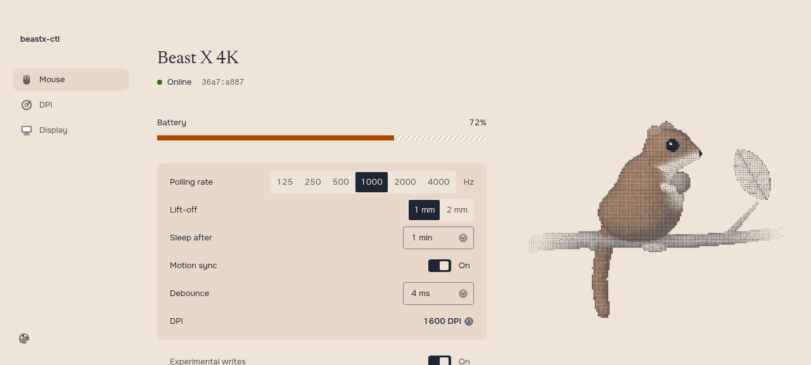

# beastx

Settings app for the WLMouse Beast X 4K on Linux. DPI, polling rate, sleep timer, battery, and a taskbar battery readout. Runs in your browser; the official app is Windows only.

<p>
  
  
</p>

## Start

Needs Node 20+ (or Bun) and Chrome, Edge, Brave or Helium. Firefox and Safari can't reach USB devices.

1. Give your user access to the receiver, then replug it:

   ```sh
   npx beastx udev | sudo tee /etc/udev/rules.d/70-beastx.rules && sudo udevadm control --reload && sudo udevadm trigger
   ```

2. Open the app:

   ```sh
   npx beastx
   ```

   Click "Pick receiver" and choose Wireless Gaming Mouse. With Bun, use `bunx beastx`.

Works the same on any distro. On macOS and Windows, skip step 1 (untested, reports welcome).

## Keep it running

Install it, then start it at login on `http://127.0.0.1:5174`:

```sh
npm install -g beastx
mkdir -p ~/.config/systemd/user && printf '[Service]\nExecStart=%s %s web --no-open\nRestart=on-failure\n\n[Install]\nWantedBy=default.target\n' "$(command -v node)" "$(readlink -f "$(command -v beastx)")" > ~/.config/systemd/user/beastx.service && systemctl --user enable --now beastx
```

Stop it with `systemctl --user disable --now beastx`.

## Taskbar battery

`beastx watch` feeds Waybar or Wayle. Config: [docs/taskbar.md](https://github.com/codewithkenzo/beastx-ctl/blob/main/docs/taskbar.md).

## Safety

- Read-only until you save a backup and turn on "Experimental writes". Both are remembered.
- No firmware updates, pairing or resets.
- Nothing leaves your computer.

## Commands

| Command                            | Does                       |
| ---------------------------------- | -------------------------- |
| `beastx`                           | Opens the app              |
| `beastx web --port 5175 --no-open` | Other port, no browser     |
| `beastx udev`                      | Prints the udev rule       |
| `beastx status`                    | Battery and DPI, once      |
| `beastx watch`                     | Battery and DPI, on change |

## Credits

Protocol notes from [rrroyal/wlmouse-beastx](https://github.com/rrroyal/wlmouse-beastx) and [mee7ya/wlmouse-cli](https://github.com/mee7ya/wlmouse-cli). Not affiliated with WLMouse. MIT.

## Develop

```sh
bun install
bun run --filter ./apps/web dev
bun run check
bun run --filter ./apps/cli bundle
```
