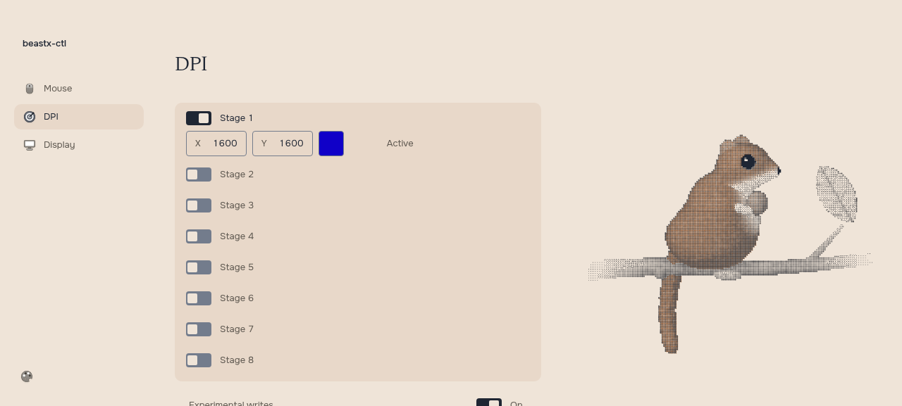

# beastx

Settings app for the WLMouse Beast X 4K on Linux. Change DPI, polling rate and sleep time, check the battery, and show it in your taskbar. The official app is Windows only; this one runs in your browser.


## Start

You need Node 20 or newer (or Bun), and Chrome, Edge, Brave or Helium. Firefox and Safari can't talk to USB devices.

**1. Let your user talk to the receiver.** Run this once, then unplug and replug the receiver:

```sh
npx beastx udev | sudo tee /etc/udev/rules.d/70-beastx.rules && sudo udevadm control --reload && sudo udevadm trigger
```

**2. Open the app:**

```sh
npx beastx
```

It opens in your browser at `http://127.0.0.1:5174`. Click "Pick receiver" and choose the Wireless Gaming Mouse. Using Bun? Swap `npx` for `bunx`.

## Keep it installed

`npx` downloads it each time. To keep it on your computer instead:

```sh
npm install -g beastx
beastx
```

To have it running all the time (always at `http://127.0.0.1:5174`), add a user service:

```ini
# ~/.config/systemd/user/beastx.service
[Unit]
Description=beastx mouse settings

[Service]
ExecStart=%h/.npm-global/bin/beastx web --no-open
Restart=on-failure

[Install]
WantedBy=default.target
```

Point `ExecStart` at the path `which beastx` prints, then run `systemctl --user enable --now beastx`.

## Taskbar battery

`beastx watch` feeds Waybar or Wayle with the battery and DPI. Setup: [docs/taskbar.md](https://github.com/codewithkenzo/beastx-ctl/blob/main/docs/taskbar.md).

## Changing settings safely



- The app only reads at first. To change settings, save a backup of your current settings, then turn on "Experimental writes". It remembers both.
- It never updates firmware, pairs devices or resets the mouse.
- Everything stays on your computer. No accounts, no network calls.

## Commands

| Command | What it does |
| --- | --- |
| `beastx` | Opens the app (same as `beastx web`) |
| `beastx web --port 5175 --no-open` | Pick a port, don't open the browser |
| `beastx udev` | Prints the udev rule |
| `beastx status` | Prints battery and DPI once |
| `beastx watch` | Prints battery and DPI whenever they change |

## macOS and Windows

The app may work there without the udev step, in Chrome or Edge. Nobody has tried it yet; tell us if it works. The taskbar commands are Linux only.

## Credits

Protocol notes from [rrroyal/wlmouse-beastx](https://github.com/rrroyal/wlmouse-beastx) and [mee7ya/wlmouse-cli](https://github.com/mee7ya/wlmouse-cli). Not affiliated with WLMouse.

## Develop

```sh
bun install
bun run --filter ./apps/web dev
bun run check
bun run --filter ./apps/cli bundle   # builds apps/cli/dist for npm
```

MIT licence.
